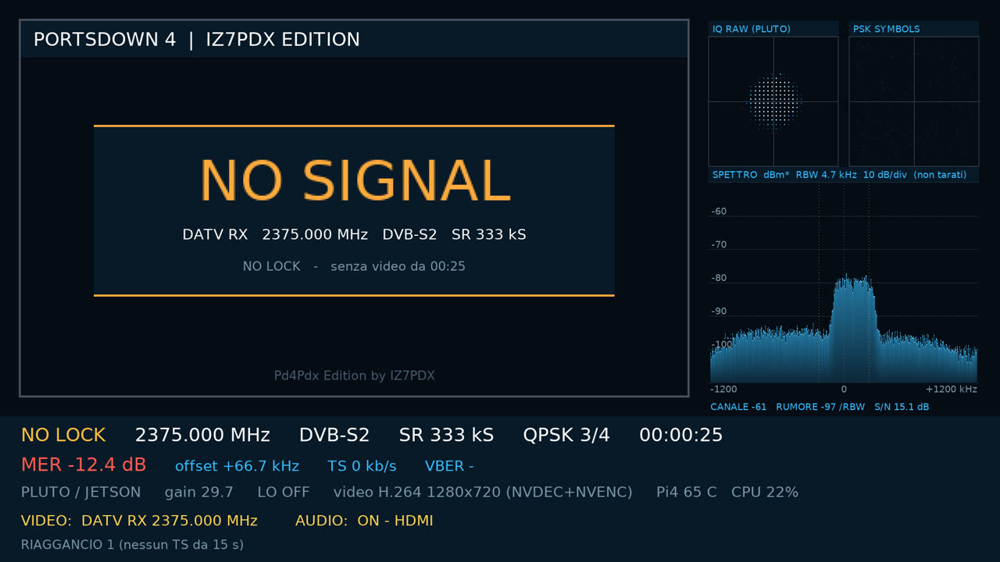

# Board not recommended: "ESP32-S3-DevKitC-1 N16R8" sold as Amazon ASIN B0G4W8YLXP

[English](#english) · [Italiano](#italiano)

## English

**Status:** tested on 15/11/2026 by IZ7PDX with firmware v1.3.0-dev (one unit). **Not recommended for this beacon.**

Product: ESP32-S3-DevKitC-1 type board with an ESP32-S3 N16R8 module (16 MB flash, 8 MB PSRAM), CH343 USB-serial
bridge, RGB LED on GPIO48, no camera — <https://www.amazon.it/dp/B0G4W8YLXP>.

The board is recognised correctly (ESP32-S3 rev 0.2, 8 MB PSRAM, 16 MB flash at 3.3 V) and runs the firmware, but
on the air we found:

| Issue | What we saw |
|---|---|
| **Large frequency error** | The beacon set to 2375.000 MHz, SR 333 kS, was received **+66.7 kHz** off (≈ 28 ppm), so the DVB-S2 receiver (Portsdown 4 / Pd4Pdx with PlutoSDR) could not lock (NO LOCK, signal 15 dB above the noise). For comparison, our ESP32-S3-CAM board and a PlutoSDR differed by about 14 kHz (≈ 6 ppm) at the same frequency. The S3 derives both the TX and the RX LO from its 40 MHz crystal, so the error affects transmission and Parrot reception alike. |
| **High chip temperature** | **79.8 °C** reported by the chip's own sensor after about 7 minutes of beacon cycles at 333 kS (our ESP32-S3-CAM boards: about 55 °C after 20 minutes at 1000 kS). The crystal drifts further with temperature. |
| **Lower output power** | Clearly weaker signal than the ESP32-S3-CAM boards in the same position (observed on the receivers, not yet measured with an instrument). |

A workaround is to set the beacon frequency lower by the measured error (here 2374.933 MHz), but then the displayed
and transmitted frequency labels are wrong, QSY frequencies must be corrected by hand and the Parrot listens on the
wrong frequency. A per-board crystal correction is planned for a future version.

**Recommendation:** use the ESP32-S3-CAM N16R8 board listed in the [README](../README.md#hardware). If you test
another board, please open an issue with the measured frequency offset, temperature and output power.

This is the result of one unit. Other batches of the same listing may behave differently.

## Italiano

**Stato:** provata il 15/11/2026 da IZ7PDX con il firmware v1.3.0-dev (un esemplare). **Sconsigliata per questo beacon.**

Prodotto: scheda tipo ESP32-S3-DevKitC-1 con modulo ESP32-S3 N16R8 (16 MB di flash, 8 MB di PSRAM), ponte
USB-seriale CH343, LED RGB su GPIO48, senza camera — <https://www.amazon.it/dp/B0G4W8YLXP>.

La scheda viene riconosciuta correttamente (ESP32-S3 rev 0.2, PSRAM 8 MB, flash 16 MB a 3,3 V) e fa girare il
firmware, ma in aria abbiamo trovato:

| Problema | Cosa abbiamo visto |
|---|---|
| **Errore di frequenza grande** | Il beacon impostato a 2375,000 MHz, SR 333 kS, è stato ricevuto a **+66,7 kHz** (≈ 28 ppm): il ricevitore DVB-S2 (Portsdown 4 / Pd4Pdx con PlutoSDR) non agganciava (NO LOCK, segnale 15 dB sopra il rumore). Per confronto, la nostra ESP32-S3-CAM e una PlutoSDR differivano di circa 14 kHz (≈ 6 ppm) alla stessa frequenza. L'S3 ricava sia il LO di trasmissione sia quello di ricezione dal quarzo da 40 MHz: l'errore pesa sulla TX e sull'ascolto del Parrot. |
| **Temperatura del chip alta** | **79,8 °C** letti dal sensore del chip dopo circa 7 minuti di cicli del beacon a 333 kS (le nostre ESP32-S3-CAM: circa 55 °C dopo 20 minuti a 1000 kS). Con il calore il quarzo deriva ancora. |
| **Potenza d'uscita più bassa** | Segnale nettamente più debole delle ESP32-S3-CAM nella stessa posizione (visto sui ricevitori, non ancora misurato con uno strumento). |

Un ripiego è impostare la frequenza del beacon più in basso dell'errore misurato (qui 2374,933 MHz), ma così la
frequenza mostrata e trasmessa nelle scritte è sbagliata, le frequenze del QSY vanno corrette a mano e il Parrot
ascolta sulla frequenza sbagliata. Una correzione del quarzo per ogni scheda è prevista in una prossima versione.

**Consiglio:** usare la scheda ESP32-S3-CAM N16R8 indicata nel [README](../README_it.md#hardware). Se provate
un'altra scheda, aprite una issue con scostamento di frequenza, temperatura e potenza d'uscita misurati.

È il risultato di un solo esemplare: altri lotti della stessa inserzione possono comportarsi diversamente.
